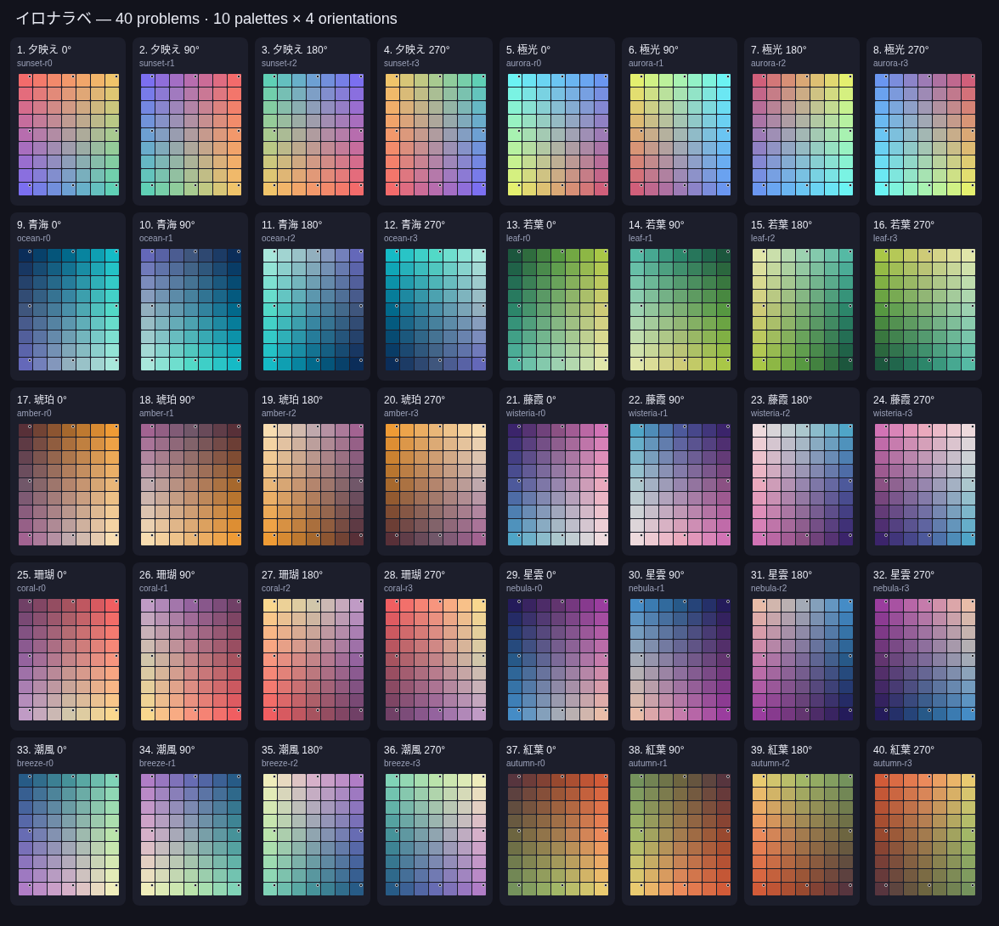

# イロナラベ40問

現在の8問を残し、基準8色を個別に変えた8配色×4方向の32問を追加する。合計10配色×4方向=40問。ホーム・遊び方・共有文・ゲーム中・結果の問題数表示も40問になり、追加配色名と可変の問題数を15言語へ翻訳した。

この一覧は実際の `index.html` と `js/stage-pack.js` の盤面生成から作る。[SVG原本](docs/stage-pack-40-preview.svg)は `node tools/render-stage-pack.cjs` で再生成できる。画像、内部資料、テスト、生成ツールは公開成果物に含めない。

| 番号 | 配色 | 内部ID | 方向 |
| --- | --- | --- | --- |
| 1–4 | 夕映え（既存） | sunset | 0° / 90° / 180° / 270° |
| 5–8 | 極光（既存） | aurora | 同上 |
| 9–12 | 青海 | ocean | 同上 |
| 13–16 | 若葉 | leaf | 同上 |
| 17–20 | 琥珀 | amber | 同上 |
| 21–24 | 藤霞 | wisteria | 同上 |
| 25–28 | 珊瑚 | coral | 同上 |
| 29–32 | 星雲 | nebula | 同上 |
| 33–36 | 潮風 | breeze | 同上 |
| 37–40 | 紅葉 | autumn | 同上 |

## 色の作り方

新しい8系列は、左上→上中→右上→右中→右下→下中→左下→左中の順に、独立した8色を指定する。90°ごとにこの8色を2位置ずつ時計回りに移す。固定8枚はこれらの色と完全一致する。

中央制御点を8色のRGB平均とし、外周8点と合わせた3×3制御点を作る。それぞれの四半盤面を双線形補間し、7列×9行の63色を生成する。中間値は丸めず、最終RGBチャンネルだけを四捨五入する。中央の縦横の境界も連続し、値のクリッピングは不要。

夕映え・極光には従来の四隅からの補間をそのまま使う。既存8問の63色、ステージ番号・ID・challenge IDは基点 `5a24e28` の固定fixtureと比較する。新しい方式で既存問を再生成しない。

40問の完成盤面はすべて異なる。追加32問の各盤面は63色すべてが異なり、8色の回転も同じ盤面を作らない。40問を1バッグとして無重複で出し、バッグの切替境界でも同じ問題を連続させない。

新しい8系列について、4方向すべてで測ったRGBユークリッド距離の最小値は以下のとおり。

| 配色 | 任意の2枚 | 隣接2枚 | 固定8色 |
| --- | ---: | ---: | ---: |
| 青海 | 14.90 | 16.43 | 65.41 |
| 若葉 | 14.76 | 14.76 | 59.92 |
| 琥珀 | 14.46 | 15.52 | 64.38 |
| 藤霞 | 14.46 | 14.46 | 58.66 |
| 珊瑚 | 12.73 | 12.73 | 51.70 |
| 星雲 | 16.09 | 16.91 | 59.04 |
| 潮風 | 13.60 | 13.75 | 56.26 |
| 紅葉 | 13.00 | 13.00 | 52.84 |

自動検査と完成図の目視確認を併用する。このRGB検査は、人間の知覚上の難易度や色覚の違いへの適合を保証する指標ではない。

## 互換性と公開

次の契約を変更しない。

- `game_slug = ironarabe`、`score_order = asc`、`score_scale = 100`、`score_decimals = 2`
- `ironarabe-official-001`、board version `2`、seed `ironarabe-official-001-v1`
- ランキング基礎client version `ironarabe-web-1.4.1-stagepack001-v2` と既存8問のsuffix
- 63枚のID、固定8座標、公式初期配置、スコア計算、既存送信/取得RPC
- 名前は任意、名前なしの開始回数queue、結果の上位30名、保存名・言語・効果音設定

UIの公開識別子だけを `ironarabe-web-1.6.0-stagepack40` に更新した。Pagesの公開allowlistへ `js/stage-pack.js` を追加し、公開するのはindex、6本の実行JS、release.jsonの8ファイルだけ。今後も既定ブランチへのPRマージ後に配備し、PR時には本番公開しない。

匿名開始RPCのallowlistも40問に対応する必要がある。実験場の [40問用DB手順](https://github.com/chameleonjp-lab/chameleonjp_lab/blob/main/docs/chameleonjp-lab/16_ironarabe_stage_pack_40.md) に、未導入の場合の初回用SQLと旧8問を導入済みの場合の関数のみ更新するSQLを用意した。DBの実際の状態と関数のfingerprintを読取確認し、管理者が適切な経路を適用する。スコア表・履歴・名前・日時・既存の開始記録を書き換えない。

**40問版は公開済み。** 利用者によるPR #18のマージ後、初回マージSHA `43b6c01655932a37828152324f0f0b7622ff9921` を[run 41165939863](https://github.com/chameleonjp-lab/ironarabe/actions/runs/41165939863)が配備し、build/deploy/公開hash検証の全jobが成功した。先行8問版の公開後受入を経てゲーム登録1件のURL2列も切替済み。匿名回数のDB適用状況と共通集計の互換性は上記のDB手順へ記録する。Pagesの再設定や旧pagesブランチへのコピーは不要。旧Codebergサイトは停止・削除していない。

## 検証

`npm test` は既存検証を残して、配色モジュールと実ゲームの40問・既存8問の固定hash・バッグ・全40匿名versionの互換性を検査する。`npm run test:browser` は既存12シナリオに加え、ChromiumとWebKitで40問ずつ実際の操作イベントから全問クリアする。縦402×874、横874×402で配置を検査し、完成63色、固定8枚、49交換、翻訳名、4秒後の結果、同じゲームへの送信を確認する。Supabase通信は全件mockし、本番へ試験スコアを送らない。

実機iPhone 17 Pro Safariは未確認。代替としてタッチ対応のモバイル設定、WebKit、縦横の画面サイズを使用する。

2026-10-31のローカル実行は、既存7検証とNode 97/97件、ブラウザ14シナリオが成功。追加2シナリオで計80クリアを確認した。実験場の24/24隔離DBケースと4つのcatalog/fallbackブラウザシナリオも成功。独立レビューでは旧8問の全タイル、追加2016タイルの補間、SQL・公開成果物を再検証し、未解決の重大な指摘なし。

先行8問版の公開受入では、マージSHAと全ファイルhashを検証し、Chromium/WebKitで実際に配信されたHTML/JSを使って15言語、音設定、縦横、開始→クリア→結果を確認した。スコア送信は遮断し、既存ランキング29件だけを本番から読み取った。環境のプロキシCAをブラウザが直接信頼しなかったため、公開ファイルと読取RPCは環境CAを検証するNode fetch経由で取得した。TLS検証は無効化していない。

その後に登録1件のURL2列のみを管理接続で更新し、game_scores 29件 / score_runs 567件の全列hashと他ゲーム登録のhashが前後で一致した。[公開・切替証拠](https://github.com/chameleonjp-lab/chameleonjp_lab/blob/main/docs/evidence/ironarabe-pages-live-20261031.json)には集約値だけを記録し、プレイヤー名や鍵を含めない。

40問版の公開後も、初回配信SHAと全ファイルhashがマージした版と一致した。Chromium/WebKitで配信中のHTML/JSを使い、15言語、40問の案内、新配色モジュール、音設定、縦横、開始→クリア→結果、本番の既存ランキング29件の読取を確認した。試験スコアの送信は遮断している。実機Safariは引き続き未確認。
